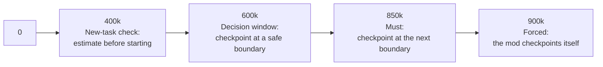
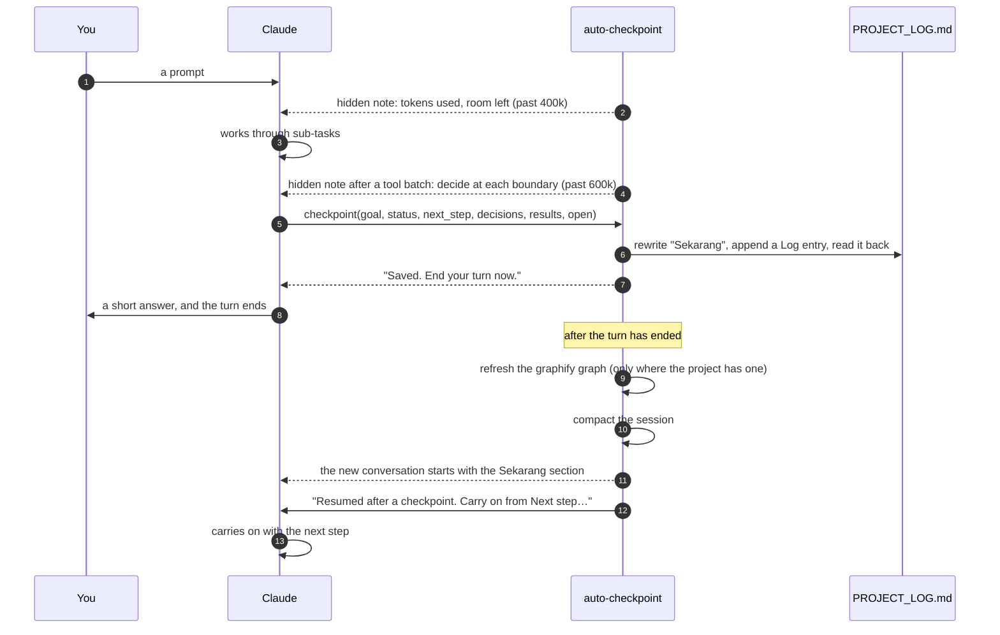
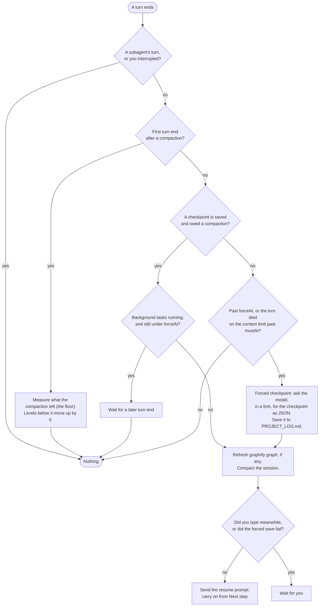

# auto-checkpoint

A Claude Code mod that lets Claude decide when to compact the conversation.

Built-in Auto-compact compacts when the context window fills, wherever Claude is, which is often in the middle of a task. With this mod, Claude watches the token count. When it is high enough, Claude waits for a safe point between sub-tasks and saves a checkpoint to `PROJECT_LOG.md`. The mod then compacts the same session, and Claude carries on from the checkpoint's next step without you typing anything.

- **Claude picks the moment.** It checkpoints between sub-tasks, never halfway through a change.
- **The log is a file.** `PROJECT_LOG.md` keeps the goal, the status, the next step and every past decision. It outlives compactions, sessions and reboots.
- **Work goes on by itself.** After a compaction the mod sends a resume prompt. Claude picks up from **Next step** in the log.
- **There is a safety net.** If Claude never checkpoints, the mod writes one itself before the window fills.
- **One switch.** `/config` → **Auto-checkpoint** turns the mod on or off. Built-in Auto-compact flips the other way with it.

---

## Install

You need Claude Code **2.1.326 or newer** (`claude --version`; run `claude update` if it is older). The mod has been tested on 2.1.331 and 2.1.332 on macOS.

At the prompt of a Claude Code terminal session:

```
/plugin install auto-checkpoint --marketplace AlifRizza/auto-checkpoint
```

When asked:

1. Answer `y` to **Add marketplace?** (`github:AlifRizza/auto-checkpoint`).
2. Pick the **user** scope (the first one) with Enter.
3. Keep the defaults on the options screen. You can change every option later in `/config`.

From a shell instead:

```
claude plugin install auto-checkpoint --marketplace AlifRizza/auto-checkpoint
```

In the desktop app, where `/plugin` does not run: click **+** next to the prompt box, then **Plugins** → **Add marketplace**, enter `AlifRizza/auto-checkpoint`, then **Add plugin**.

### Check that it works

1. Start a **new** session.
2. Open `/config`. You should see:
   - **Auto-checkpoint · auto-checkpoint** set to **on**.
   - Built-in **Auto-compact** set to **off**. The mod turns it off when a session starts.
3. Type `/` and check that **/save-checkpoint** is in the list.

To try a full cycle in an empty folder, send:

```
Create notes.txt with the line "one". Then call the checkpoint tool with goal "test the mod",
status "notes.txt has one line", next_step "append the line two to notes.txt", and end your turn.
```

You should see three things. `PROJECT_LOG.md` appears. The session compacts. A turn starts by itself, marked "Prompt from the auto-checkpoint plugin", and `notes.txt` ends up with `one` and `two`.

---

## How it works

### The four levels

The mod reads the session's context size after every prompt and every tool batch, and compares it with four levels:

| Level | Default | What happens |
| --- | --- | --- |
| **New-task check** (`taskCheckAt`) | 400k | Each prompt carries a hidden note with the tokens used and the room left. If your message starts a new task, Claude estimates its size before it begins. If the task does not fit, Claude suggests a checkpoint first. |
| **Decision window** (`decideAt`) | 600k | Claude is told to check at the end of each sub-task whether the next one can be done well from the log alone. If yes, it calls `checkpoint` and ends its turn. If no, it keeps working and checks again at the next boundary. |
| **Must checkpoint** (`mustAt`) | 850k | Claude is told to checkpoint at the very next sub-task boundary. |
| **Forced checkpoint** (`forceAt`) | 900k | A turn that ends here with no checkpoint gets one from the mod. |

The notes are hidden context on your prompt or after a tool batch. They never go into the system prompt, so they do not break the prompt cache. A note that arrives mid-turn is sent once per level.



The levels assume a 1M-token window. On a smaller window they scale down with it. On a 200k model, for example, they become 80k / 120k / 170k / 180k, so a forced checkpoint still comes in time.

### A checkpoint, step by step



### What the mod decides at the end of each turn



### The rules that keep it safe

- **A stale checkpoint is dropped.** Claude may checkpoint and then keep working in the same turn. If another tool batch runs after the checkpoint's own batch, the log no longer matches the work. The mod drops the checkpoint, shows a toast, and Claude checkpoints again later.
- **You come first.** If you send a message while a compaction is owed, the mod still compacts but does not resume over you, and your message is what Claude works on next. The same applies if you typed during the turn that held the checkpoint. A background task's notification does not count as you.
- **A question waits for you.** If Claude's last answer before the checkpoint asked you something, the resume prompt tells it to wait for your reply.
- **Background work.** If shells, monitors or agents are still running when a turn ends, the compaction waits for a turn end with none running. Past `forceAt` it stops waiting, because a dev server may never end.
- **The post-compaction floor.** A compaction never takes the context to zero: the system prompt, the tools, startup hooks and the summary remain, often 50–80k. At the first turn end after each compaction, the mod measures that floor. Any levels below it move up by it, keeping their spacing and staying under 90% of the window. Without this, low levels would force a checkpoint after every turn.
- **A forced save that fails.** If the forced checkpoint cannot be saved, the mod still compacts, so the window does not overflow. It does not resume, because the log's next step would be stale. Claude waits for you.
- **A vetoed compaction** (another plugin said no) is not retried on every turn. It is retried once the context is back under `forceAt`.
- **Subagents** cannot checkpoint, and their turns trigger nothing.
- **No permission prompt.** The `checkpoint` tool is answered before the permission check, so an unattended session never stops at a dialog. All the tool does is write `PROJECT_LOG.md` and schedule a compaction.

---

## `PROJECT_LOG.md`

The file sits at the project root (the session's folder). "Sekarang" is Indonesian for "Now".

```markdown
# PROJECT_LOG
<!-- auto-checkpoint -->

## Sekarang
**Goal:** Ship the CSV export
**Status:** Dedup done on batch 15
**Next step:** Run the export for all batches

## Log

### 2026-11-18 10:40 UTC
**Decisions:**
- Match on email first
**Results:**
- Batch 15: 37 duplicates removed
**Open:**
- Batch 9 lacks emails
```

- **Sekarang** is rewritten at every checkpoint. Its three lines go to Claude as context at the start of each conversation and after each compaction. Claude reads the full **Log** only when it needs past decisions.
- **Log** keeps every entry, newest last, stamped in UTC.
- **Your own text is kept.** That includes a title, a preamble, or sections of your own between Sekarang and Log. A file you wrote by hand with no `## Log` is kept whole as the first entry, "Earlier notes".
- **The marker line** `<!-- auto-checkpoint -->` tells the mod that it wrote the file. A `PROJECT_LOG.md` in a repository you cloned is never sent to Claude until a checkpoint rewrites it.
- **Past 1 MiB**, the oldest entries move to a new `PROJECT_LOG.archive-<time>.md` beside it. Nothing is deleted.
- **Two sessions** in the same folder do not overwrite each other. If the file changed under a save, the entry is written again onto the other session's version.

---

## Settings

Everything is in `/config`, under **auto-checkpoint**:

| Row | Default | Meaning |
| --- | --- | --- |
| **Auto-checkpoint** | on | The main switch. **On**: the mod works, and built-in Auto-compact is turned off. **Off**: the mod does nothing, and built-in Auto-compact is turned back on. Takes effect at once. |
| **New-task check (tokens)** | 400000 | From here, each prompt asks Claude to check whether a new task fits. |
| **Decision window (tokens)** | 600000 | From here, Claude looks for a safe boundary to checkpoint. |
| **Must checkpoint (tokens)** | 850000 | From here, Claude checkpoints at the very next boundary. |
| **Forced checkpoint (tokens)** | 900000 | A turn that ends here with no checkpoint gets one from the mod. |
| **Refresh graphify graph** | on | Before compacting, refresh the project's graphify graph (`graphify update`), where `graphify-out/graph.json` exists. Projects without one are left alone. |

- The four levels must each be **20000 or more** and **rise in that order**. If one does not, all four fall back to the defaults and a toast says so.
- `/config` saves plugin options in your **user** settings, so they apply to every session.

### Commands

- **`/save-checkpoint`** asks Claude to checkpoint at its next safe boundary, or right away if it is between sub-tasks. Use it before you start something new and large.

---

## Turning it off, and uninstalling

- **To pause it:** `/config` → **Auto-checkpoint** → off. Built-in Auto-compact comes back on by itself.
- **To uninstall:**
  1. Turn the mod off in `/config` first, so built-in Auto-compact is back on.
  2. Then run:

     ```
     claude plugin uninstall auto-checkpoint
     ```

  If you uninstall without turning it off first, turn **Auto-compact** back on in `/config` yourself.

---

## Limits

- **Code Mode.** The mod hooks no tool but its own `checkpoint`, so Code Mode keeps its behaviour on every other tool. A Code Mode script counts as one tool batch, so the mod cannot see a call made after `checkpoint` inside the same script. The tool's description tells Claude to make `checkpoint` the last call. This path has not been tested live yet.
- **Organization-managed installs** skip `classic.*` hooks. There the mid-turn notes, the stale-checkpoint check and the wait for background work do not run.
- **Prompt too long.** With built-in Auto-compact off, a request that overflows the window before the mod checkpoints fails as too long. The mod then forces a checkpoint at the end of that turn. If you see this often, lower **Forced checkpoint** and **Must checkpoint** a little.
- **Two sessions, same instant.** The API has no file lock. A write from another session that lands after this session's read-back can still drop one entry.
- **Windows** is not supported. The mod expects POSIX paths.

---

## Files

```
.claude-plugin/plugin.json        manifest and the /config options
.claude-plugin/marketplace.json   makes this repository installable
hooks/hooks.json                  names the hooks module
hooks/register.ts                 wiring: hooks on prompts, tool batches, turn ends, the checkpoint tool
hooks/log.ts                      pure logic: levels, notes, the log format, prompts, the tool's schema
types/index.d.ts                  what the mod keeps in session state across a reload
tests/                            60 tests for the Claude Code test kit
```

## Development

```
git clone https://github.com/AlifRizza/auto-checkpoint
cd auto-checkpoint
claude plugin test .        # runs tests/*.test.ts
claude plugin validate .    # reads the manifest, the marketplace file and the hooks module
claude --plugin-dir .       # a session with this copy loaded
```

`tsconfig.json` extends the types Claude Code writes into `.claude-plugin/types/` the first time it loads the mod. After that, `npx -p typescript tsc -p .` type-checks it.
